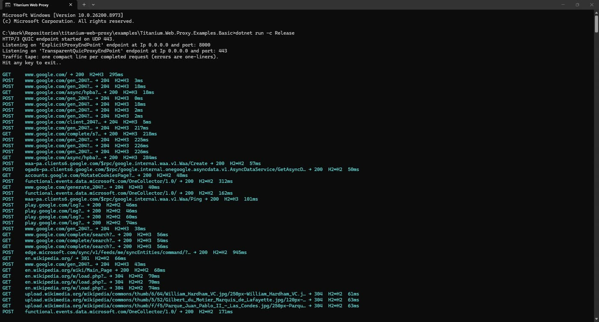
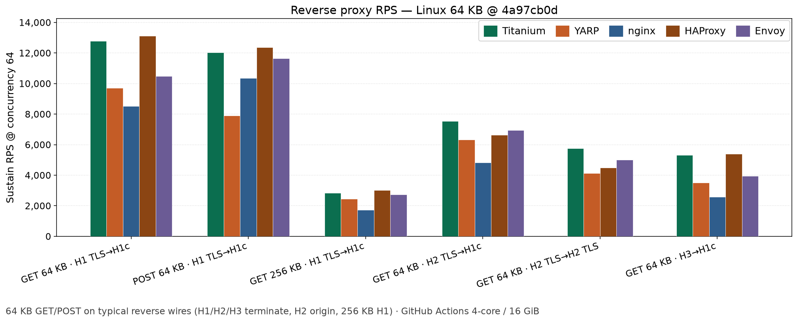

# Titanium Web Proxy

Embeddable .NET 10 HTTP(S) and MITM library, standalone CLI and Kubernetes reverse proxy, and desktop MITM debugger — on Windows, Linux, and macOS.

[](https://github.com/justcoding121/titanium-web-proxy/actions/workflows/dotnetcore.yml?query=branch%3Adevelop+event%3Apush)
[](https://www.nuget.org/packages/Titanium.Web.Proxy)
[](https://www.nuget.org/packages/Titanium.Web.Proxy)

**[Website](https://titaniumproxy.com)** · [Download](https://titaniumproxy.com/download) · [Library](#run-the-library) · [CLI](#run-the-cli) · [Benchmarks](#performance) · [Docs](https://titaniumproxy.com/docs/getting-started) · [License](#license)

## Run the library

```shell
dotnet add package Titanium.Web.Proxy
# Prerelease / beta:
dotnet add package Titanium.Web.Proxy --prerelease
```

Explicit HTTP(S) proxy on `127.0.0.1:8000` that logs each requested URL:

```csharp
using System;
using System.Net;
using System.Threading.Tasks;
using Microsoft.Extensions.Logging;
using Titanium.Web.Proxy;
using Titanium.Web.Proxy.EventArguments;
using Titanium.Web.Proxy.Models;

using var proxyServer = new ProxyServer();

proxyServer.Logging.MinimumLevel = LogLevel.Information;
proxyServer.BeforeRequest += OnRequest;

var endPoint = new ExplicitProxyEndPoint(IPAddress.Loopback, 8000, decryptSsl: true);
proxyServer.AddEndPoint(endPoint);

// The first run installs a root certificate in the current user's trust store.
proxyServer.CertificateManager.EnsureRootCertificate(
    userTrustRootCertificate: true,
    machineTrustRootCertificate: false);

proxyServer.Start();
proxyServer.Logger.LogInformation("Proxy listening on 127.0.0.1:8000. Press Enter to stop.");
await Console.In.ReadLineAsync();
proxyServer.Stop();

Task OnRequest(object sender, SessionEventArgs e)
{
    proxyServer.Logger.LogInformation("{Url}", e.HttpClient.Request.Url);
    return Task.CompletedTask;
}
```

Point your client at `127.0.0.1:8000` as its HTTP and HTTPS proxy. The first run installs a root certificate for the current user — only on a machine you control. [Trust](#trust-and-native-scripting).


| Product | Best for |
|---------|----------|
| **Titanium.Web.Proxy**<br>[NuGet](https://www.nuget.org/packages/Titanium.Web.Proxy) | Embed a proxy (MITM and/or reverse) in a .NET app |
| **Titanium.Cli** (`titanium` / `twp`)<br>[Download](https://titaniumproxy.com/download#stable-cli) | Standalone reverse / edge proxy from the command line |
| **Titanium Inspector**<br>[Download](https://titaniumproxy.com/download#stable-inspector) | Desktop MITM debugger — session grid, inspectors, AutoResponder, breakpoints, HAR export |
| **Titanium.Plus**<br>`titanium update --plus` (after installing CLI) | Optional extra features for CLI such as control plane, dashboard, observability |

Requires .NET 10 or later for the library. CLI and Inspector downloads are self-contained (no SDK needed to run them).

## Major features

| Pillar | What you get | Start here |
|--------|--------------|------------|
| **Embeddable .NET HTTP(S) & MITM** (`Titanium.Web.Proxy`) | Same engine inside your app — inspect, modify, or reverse-proxy traffic | [NuGet](https://www.nuget.org/packages/Titanium.Web.Proxy) · [Library](https://titaniumproxy.com/docs/library) |
| **Standalone CLI & Kubernetes edge** (`titanium` / `twp`) | Reverse / edge proxy from YAML, Docker, or Helm | [Download CLI](https://titaniumproxy.com/download#stable-cli) · [CLI](https://titaniumproxy.com/docs/cli) · [Kubernetes](https://titaniumproxy.com/docs/kubernetes) |
| **Automatic block & TLS-fingerprint tunneling** | When a server blocks the proxy, we detect it and tunnel that traffic | [Features](https://titaniumproxy.com/docs/features#inspector) |
| **Visual MITM traffic debugger** (Titanium Inspector) | Session grid, inspectors, AutoResponder, breakpoints, HAR export | [Download Inspector](https://titaniumproxy.com/download#stable-inspector) · [Inspector](https://titaniumproxy.com/docs/inspector) |
| **Benchmarked speed at scale** | Practical reverse RPS vs peers on the same harness | [Performance](#performance) · [Site charts](https://titaniumproxy.com/docs/performance) |
| **Optional control-plane add-ons** (`Titanium.Plus`) | xDS, GeoIP, caching, rate limiting, health probes, dashboard | `titanium update --plus` · [Plus](https://titaniumproxy.com/docs/plus) |

## Run the CLI

### CLI (reverse / edge proxy)

Create `twp.yaml`, then validate and run:

```yaml
schemaVersion: "7.1"
listeners:
  - host: "127.0.0.1"
    port: 8000
    # false = plain reverse proxy (no HTTPS decrypt)
    decryptSsl: false
    forwardHost: "127.0.0.1"
    forwardPort: 8080
```

```shell
titanium test -c twp.yaml
titanium run -c twp.yaml
```



## Go deeper

Full catalog: [Features](https://titaniumproxy.com/docs/features). What is supported, partial, and not supported: [capability coverage](https://titaniumproxy.com/docs/capabilities). Protocol coverage: [protocol support matrix](https://github.com/justcoding121/titanium-web-proxy/wiki/Protocol-Support). HTTP/3 packaging: [HTTP/3 wiki](https://github.com/justcoding121/titanium-web-proxy/wiki/HTTP-3).

## Performance

Tiny keep-alive GET (~56 B) on common reverse wires, plus WebSocket and unary gRPC:


Heavier reverse load (64 KB GET/POST on typical wires):



**RPS** is requests per second (gRPC bars are **RPC/s**). **45,499** requests per second on Linux for a tiny keep-alive GET (~56 B), HTTP/1 with TLS in and plain HTTP/1 out (4 vCPU / 16 GiB, median of 3, sustain at concurrency 64), on the same harness as peer proxies. Named comparison: [Performance](https://github.com/justcoding121/titanium-web-proxy/wiki/Performance).

## Installation

**Inspector and CLI** (Windows, Linux, macOS): use [Download](https://titaniumproxy.com/download) — MSI / DMG / AppImage / `.deb` / `.rpm` / zip. Short walkthrough: [Install](https://titaniumproxy.com/docs/install).

After the CLI is on your PATH (or in the current folder):

```shell
titanium run -c twp.yaml
titanium test -c twp.yaml
titanium version --check
titanium update
```

`titanium run` is foreground (Ctrl+C to stop). Boot persistence: `titanium service install -c twp.yaml` — [CLI — service](https://titaniumproxy.com/docs/cli#service). Each CLI zip also includes a `twp` alias.

**Optional Plus:** `titanium update --plus`, then `plus.enabled: true` — [Plus](https://titaniumproxy.com/docs/plus).

**Container and Helm:** the CLI ships as a hardened image (`ghcr.io/justcoding121/titanium-web-proxy`, linux/amd64 and linux/arm64) and charts under `deploy/helm/` (also Release `.tgz` and `oci://ghcr.io/justcoding121/charts`) — [Kubernetes](https://titaniumproxy.com/docs/kubernetes). Gateway API / Ingress: [Gateway API](https://titaniumproxy.com/docs/gateway-api).

The image entrypoint is `titanium run --config /etc/titanium/twp.yaml`. Mount a directory that already contains `twp.yaml` (the listener must be `0.0.0.0:8080` so the published port reaches it):

```shell
mkdir conf
cat > conf/twp.yaml <<'EOF'
schemaVersion: "7.1"
listeners:
  - host: "0.0.0.0"
    port: 8080
    decryptSsl: false
    forwardHost: "127.0.0.1"
    forwardPort: 8080
EOF
docker run --rm -p 8080:8080 --read-only --tmpfs /tmp -v "$PWD/conf:/etc/titanium:ro" ghcr.io/justcoding121/titanium-web-proxy:latest
```

From a clone of this repo:

```shell
helm install titanium deploy/helm/titanium -n proxy --create-namespace -f my-values.yaml
```

## Upgrading from 7.x

Moving from 7.x to 8.0: [migration guide](docs/migration-7-to-8.md) · [website](https://titaniumproxy.com/docs/migration-7-to-8).

## Trust and native scripting

Trusting a generated root certificate changes the current user's certificate store — only do this on a machine you control.

Lua 5.4 and proxy-wasm scripting ship with the CLI (`titanium scripting-deps`). Container images include Lua and Wasmtime natives per RID. Details: [Scripting](https://titaniumproxy.com/docs/scripting).

## What you can do

- Decrypt and inspect HTTPS in a native desktop Inspector on Windows, macOS, and Linux — AutoResponder, Map Local/Remote, breakpoints, Composer, HAR, curl/fetch
- Speak modern HTTP — HTTP/2 by default, optional HTTP/3, WebSocket, gRPC, SSE, GraphQL rules in the same grid
- Run the same engine as a reverse / edge proxy from the CLI — YAML routes, load balancing and failover, retries, rate limits, response compression, gRPC-Web, TCP and UDP relay, ACME, live reload, Lua 5.4 and proxy-wasm scripting (`titanium scripting-deps`)
- Deploy on Kubernetes with a hardened container image, Helm charts (git, Release `.tgz`, or OCI), probes, a Gateway API / Ingress controller, and an optional Manager control plane; hot restart for TCP without a gap
- Observe it with Prometheus text, OTLP traces and metrics, and an access log; Plus adds a dashboard, OpenID Connect login, a response cache, fleet rate limits, xDS, and WAF screening
- Embed in .NET via NuGet; when a server blocks the proxy (TLS fingerprinting or other reasons), we detect it and automatically tunnel that traffic

## Examples and documentation

- **[Website](https://titaniumproxy.com)** — product docs, [download](https://titaniumproxy.com/download), [getting started](https://titaniumproxy.com/docs/getting-started), [features](https://titaniumproxy.com/docs/features), [release notes](https://titaniumproxy.com/releases)
- **[Wiki](https://github.com/justcoding121/titanium-web-proxy/wiki)** — deeper guides (performance, streaming bodies, HTTP/3, protocol support) and a short [Features](https://github.com/justcoding121/titanium-web-proxy/wiki/Features) pointer
- [Basic console proxy](examples/Titanium.Web.Proxy.Examples.Basic)
- [WPF desktop example](examples/Titanium.Web.Proxy.Examples.Wpf)
- [Windows service example](examples/Titanium.Web.Proxy.Examples.WindowsService)
- [API reference](https://titaniumproxy.com/api/Titanium.Web.Proxy.ProxyServer.html)

## Support and contributing

- Bugs and feature requests: [GitHub Issues](https://github.com/justcoding121/Titanium-Web-Proxy/issues)
- Programming questions: [Stack Overflow](https://stackoverflow.com/questions/tagged/titanium-web-proxy) (`titanium-web-proxy` tag)
- Pull requests welcome — see [CONTRIBUTING.md](CONTRIBUTING.md) (includes local QA tooling for maintainers)

## Code quality

[](https://sonarcloud.io/summary/overall?id=justcoding121_titanium-web-proxy&branch=develop)
[](https://sonarcloud.io/summary/overall?id=justcoding121_titanium-web-proxy&branch=develop)
[](https://sonarcloud.io/summary/overall?id=justcoding121_titanium-web-proxy&branch=develop)
[](https://sonarcloud.io/summary/overall?id=justcoding121_titanium-web-proxy&branch=develop)
[](https://sonarcloud.io/summary/overall?id=justcoding121_titanium-web-proxy&branch=develop)
[](https://sonarcloud.io/summary/overall?id=justcoding121_titanium-web-proxy&branch=develop)
[](https://sonarcloud.io/summary/overall?id=justcoding121_titanium-web-proxy&branch=develop)
[](https://sonarcloud.io/summary/overall?id=justcoding121_titanium-web-proxy&branch=develop)
[](https://sonarcloud.io/summary/overall?id=justcoding121_titanium-web-proxy&branch=develop)
[](https://sonarcloud.io/summary/overall?id=justcoding121_titanium-web-proxy&branch=develop)
[](https://sonarcloud.io/summary/overall?id=justcoding121_titanium-web-proxy&branch=develop)

## Maintainers

Actively maintained by [justcoding121](https://github.com/justcoding121). Past collaborator: [honfika](https://github.com/honfika).

## License

`Titanium.Web.Proxy`, `Titanium.Cli`, Titanium.Manager, Titanium.Gateway, docs, and this website are [MIT](LICENSE). Titanium Inspector, Titanium.Plus, Titanium.Xds, and Titanium.Cli.GeoIp are [PolyForm Noncommercial 1.0.0](licenses/PolyForm-Noncommercial-1.0.0.txt). Product overview: [titaniumproxy.com](https://titaniumproxy.com) · [Editions & licenses](https://titaniumproxy.com/docs/editions).

Vendored xDS protos keep their Apache-2.0 text in `src/Titanium.Xds/LICENSE.Apache-2.0.txt` and `src/Titanium.Xds/NOTICE`. Third-party notices for the MIT library are in `src/Titanium.Web.Proxy/NOTICE`.

| Folder | License |
|--------|---------|
| `src/Titanium.Web.Proxy`, `src/Titanium.Web.Proxy.Abstractions`, `src/Titanium.Web.Proxy.Configuration`, `src/Titanium.Web.Proxy.Scripting`, `src/Titanium.Cli`, `src/Titanium.Manager`, `src/Titanium.Gateway`, examples, website, docs, wiki, tools, deploy, and tests other than the four PolyForm test projects | MIT |
| `src/Titanium.Plus`, `src/Titanium.Inspector`, `src/Titanium.Xds`, `src/Titanium.Cli.GeoIp`, `tests/Titanium.Plus.Tests`, `tests/Titanium.Inspector.Tests`, `tests/Titanium.Xds.Tests`, `tests/Titanium.Cli.GeoIp.Tests` | PolyForm Noncommercial 1.0.0 |
