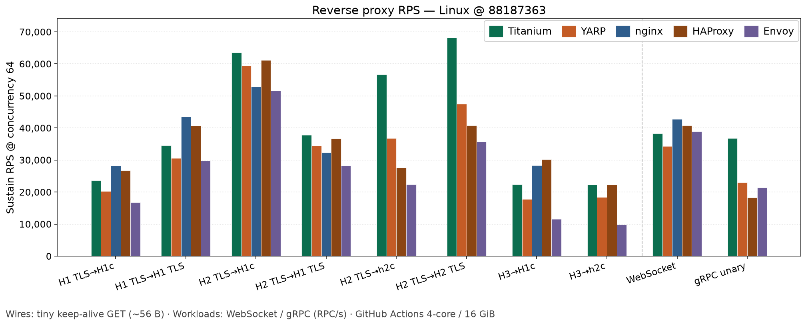

## What do you want to do?

<div class="edition-grid">
  <div class="edition-card">
    <h3>Inspect traffic</h3>
    <p class="license"><a href="/download#stable-inspector">Inspector</a> · Windows / macOS / Linux</p>
    <p>Desktop debugger for HTTP and HTTPS. Free for personal and education use (<a href="/docs/editions">PolyForm Noncommercial</a>); commercial use needs a separate license. <a href="/download#stable-inspector">Download</a> → <a href="/docs/inspector">Inspector guide</a>.</p>
  </div>
  <div class="edition-card">
    <h3>Run a reverse proxy</h3>
    <p class="license"><a href="/download#stable-cli">CLI</a> · MIT</p>
    <p>Standalone proxy for any backend stack. <a href="/download#stable-cli">Download CLI</a> → <a href="/docs/cli">CLI guide</a>.</p>
  </div>
  <div class="edition-card">
    <h3>Ops add-on</h3>
    <p class="license"><a href="/docs/plus">Plus</a> · optional</p>
    <p>Dashboard, metrics, auth helpers, and WAF request screening with a detect mode. After the CLI: <code>titanium update --plus</code>. <a href="/docs/plus">Plus</a>.</p>
  </div>
  <div class="edition-card">
    <h3>Embed in .NET</h3>
    <p class="license"><a href="https://www.nuget.org/packages/Titanium.Web.Proxy">Library</a> · NuGet · MIT</p>
    <p>Same engine inside your app. <a href="/docs/library">Library guide</a> · <a href="https://www.nuget.org/packages/Titanium.Web.Proxy">NuGet</a>.</p>
  </div>
</div>

## Performance

Throughput (requests per second) vs **YARP**, **nginx**, **HAProxy**, and **Envoy** on GitHub Actions runners. The Linux tiny-GET chart is below. Charts for the other operating systems, and all other results, are on the [performance](/docs/performance) page.

<div class="rps-preview">



</div>

## Quick start

::: code-group

```shell [CLI]
# Download a CLI zip from /download, then:
titanium test -c twp.yaml
titanium run -c twp.yaml
```

```yaml [twp.yaml]
schemaVersion: "7.1"
listeners:
  - host: "127.0.0.1"
    port: 8000
    # false = plain reverse proxy (no HTTPS decrypt)
    decryptSsl: false
    forwardHost: "127.0.0.1"
    forwardPort: 8080
```

```csharp [Library (.NET)]
using System.Net;
using Titanium.Web.Proxy;
using Titanium.Web.Proxy.Models;

using var proxyServer = new ProxyServer();
proxyServer.BeforeRequest += async (s, e) =>
{
    Console.WriteLine(e.HttpClient.Request.Url);
};

var endPoint = new ExplicitProxyEndPoint(IPAddress.Loopback, 8000, decryptSsl: true);
proxyServer.AddEndPoint(endPoint);
proxyServer.CertificateManager.EnsureRootCertificate(
    userTrustRootCertificate: true,
    machineTrustRootCertificate: false);
proxyServer.Start();
```

:::

## Next steps

- [Download CLI & Inspector](/download)
- [Getting started](/docs/getting-started)
- [Features](/docs/features)
- [Performance](/docs/performance)
- [Configuration](/docs/configuration)
- [Release notes](/releases)
- [API reference](/api/Titanium.Web.Proxy.ProxyServer.html){target="_blank" rel="noreferrer"}
