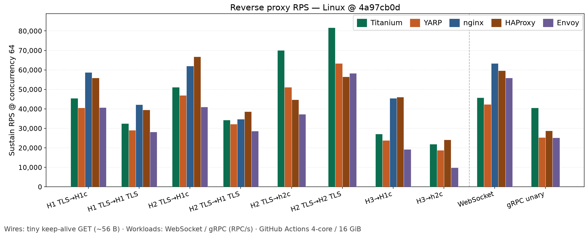

## Performance

Throughput (requests per second) vs **YARP**, **nginx**, **HAProxy**, and **Envoy** on GitHub Actions runners. The Linux tiny-GET chart is below. Charts for the other operating systems, and all other results, are on the [performance](/docs/performance) page.

## More capabilities

  

    <h3>Debug HTTPS traffic</h3>
    
Native desktop Inspector on Windows, macOS, and Linux — decrypt HTTPS, turn on system proxy, and inspect sessions, headers, and bodies. Only on machines you control.

    
<a href="/docs/inspector">Inspector guide →</a>

  

  

    <h3>Rewrite and replay</h3>
    
AutoResponder, Map Local, Map Remote, breakpoints, and Composer. Export or import HAR; copy sessions as curl or fetch.

    
<a href="/docs/inspector#right-pane-inspect-and-tools">Rewrite tools →</a>

  

  

    <h3>Automatic tunnel</h3>
    
When a server blocks the proxy (TLS fingerprinting or other reasons), we detect it and automatically tunnel that traffic.

    
<a href="/docs/features#inspector">Inspector features →</a>

  

  

    <h3>HTTP/1 · HTTP/2 · HTTP/3</h3>
    
HTTP/2 is on by default. HTTP/3 is on when QUIC is available. Bridge when client and backend differ. Inspect WebSocket, gRPC, SSE, and GraphQL in the same grid.

    
<a href="/docs/protocol-support">Protocol support →</a>

  

  

    <h3>Reverse proxy from the CLI</h3>
    
Download the CLI, write a short YAML file, and run `titanium`. Routes, TLS, and optional automatic certificates (ACME).

    
<a href="/docs/cli">CLI guide →</a>

  

  

    <h3>Zero-downtime reload</h3>
    
Change routes and backends with `titanium reload` while current connections stay up. SIGHUP does the same on Linux and macOS, and `--watch` follows Kubernetes ConfigMap updates.

    
<a href="/docs/cli#reload-without-restart">Reload without restart →</a>

  

  

    <h3>Balance and fail over</h3>
    
Round-robin, random, least requests, and least time. Health checks eject a failing backend, retries move a request to another one within a budget, and a cookie or header can pin a client to one.

    
<a href="/docs/configuration#routes-clusters">Routes and clusters →</a>

  

  

    <h3>Secure at the edge</h3>
    
Set a TLS floor, get ACME certificates, rate-limit by client or header, ask an external service to authorize each request, and add OpenID Connect login and WAF screening with Plus.

    
<a href="/docs/capabilities#auth-methods">Auth methods →</a>

  

  

    <h3>Kubernetes native</h3>
    
A hardened container image, a Helm chart with probes and a graceful drain, and a Gateway API and Ingress controller.

    
<a href="/docs/kubernetes">Kubernetes guide →</a>

  

  

    <h3>Observe everything</h3>
    
Prometheus metrics, OTLP traces and metrics with W3C trace context, a JSON access log, and a Plus dashboard.

    
<a href="/docs/configuration#observability">Observability →</a>

  

  

    <h3>Chain and authenticate</h3>
    
Forward through an upstream HTTP, HTTPS, or SOCKS proxy. Proxy auth, mTLS, Kerberos, and NTLM are included.

    
<a href="/docs/library">Library guide →</a>

  

  

    <h3>Cache, compress, protect</h3>
    
A shared response cache that skips `Set-Cookie` and private responses (Plus), gzip and brotli response compression, and caps on request bodies, headers, and decompression ratio.

    
<a href="/docs/capabilities#compression">Compression and caching →</a>

  

## Choose a path

  

    <h3>Inspect traffic</h3>
    
<a href="/download#stable-inspector">Inspector</a> · Windows / macOS / Linux

    
Desktop debugger for HTTP and HTTPS. Non-commercial use only (<a href="/docs/editions">PolyForm Noncommercial</a>). <a href="/download#stable-inspector">Download</a> → <a href="/docs/inspector">Inspector guide</a>.

  

  

    <h3>Run a reverse proxy</h3>
    
<a href="/download#stable-cli">CLI</a> · MIT

    
Standalone proxy for any backend stack. <a href="/download#stable-cli">Download CLI</a> → <a href="/docs/cli">CLI guide</a>.

  

  

    <h3>Ops add-on</h3>
    
<a href="/docs/plus">Plus</a> · optional

    
Dashboard, metrics, auth helpers, and WAF request screening with a detect mode. Non-commercial use only. After the CLI: <code>titanium update --plus</code>. <a href="/docs/plus">Plus</a>.

  

  

    <h3>Embed in .NET</h3>
    
<a href="https://www.nuget.org/packages/Titanium.Web.Proxy">Library</a> · NuGet · MIT

    
Same engine inside your app. <a href="/docs/library">Library guide</a> · <a href="https://www.nuget.org/packages/Titanium.Web.Proxy">NuGet</a>.

  

## Licensing

  

    <h3>Open source (MIT)</h3>
    
Library · CLI · Gateway · this site

    
<code>Titanium.Web.Proxy</code>, <code>Titanium.Cli</code>, Manager, Gateway, docs, and the website are MIT-licensed for commercial and non-commercial use.

  

  

    <h3>Inspector &amp; Plus (noncommercial)</h3>
    
PolyForm Noncommercial

    
Titanium Inspector, Titanium.Plus, and the xDS / GeoIP satellites are free for personal and education use. Commercial use needs a separate arrangement. Full terms: <a href="/docs/editions">Editions &amp; licenses</a>.

  

## Next steps

- [Download CLI & Inspector](/download)
- [Getting started](/docs/getting-started)
- [Features](/docs/features)
- [Performance](/docs/performance)
- [Configuration](/docs/configuration)
- [Release notes](/releases)
- [API reference](/api/Titanium.Web.Proxy.ProxyServer.html){target="_blank" rel="noreferrer"}
